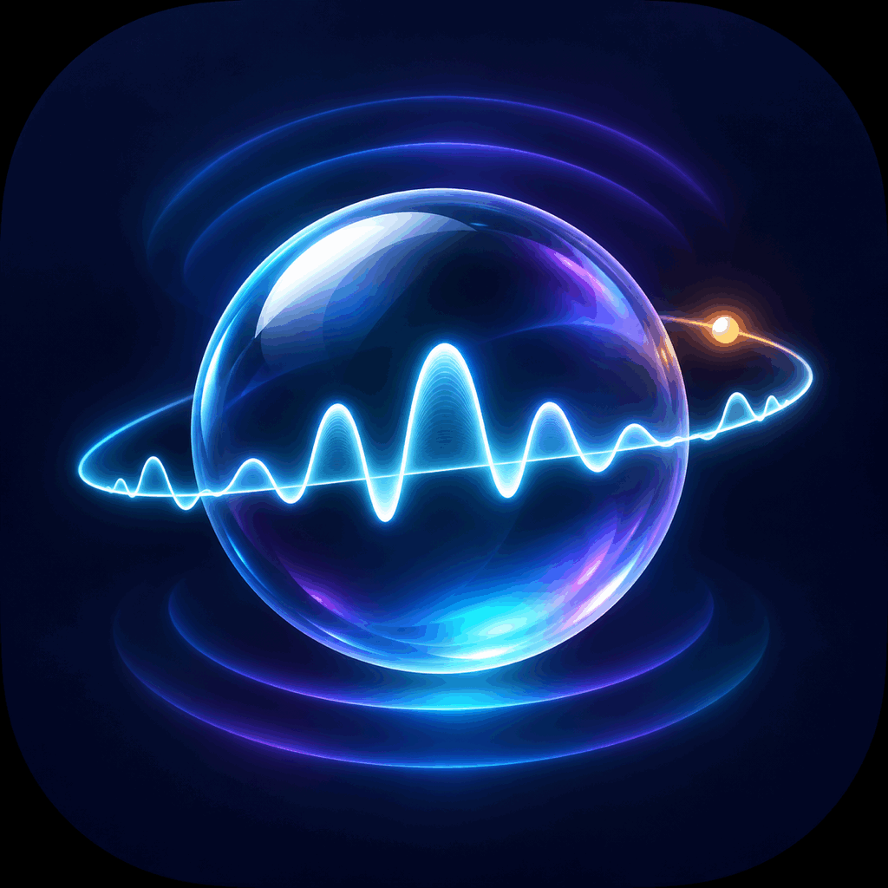

<div align="center">



# Orbplay

### Spatial audio for your Mac.

**Shape system audio in real time with a 10-band equalizer, directional stereo positioning, and optional camera-based head tracking.**

[Website](https://argyrios-dev.github.io/Orbplay/) · [Download for Apple silicon](https://github.com/argyrios-dev/Orbplay/releases/latest) · [Report an issue](https://github.com/argyrios-dev/Orbplay/issues) · [MIT License](LICENSE)

</div>

---

## What Orbplay does

Orbplay is a native macOS menu bar audio processor. It captures the system mix with Apple's Core Audio process-tap APIs, applies a real-time DSP chain, and plays the processed signal through the output you choose. That lets it work with audio from apps such as Music, Spotify, Safari, and messaging apps without an in-app plugin.

- **Directional listening controls:** place the stereo image in front, behind, left, or right of the listener; recenter it with one click.
- **Optional face tracking:** use the built-in camera and Apple's Vision face landmarks to detect head turns and keep the virtual source listener-relative. Choose Low, Medium, or High sensitivity and recenter your head position.
- **10-band equalizer:** adjust 31 Hz–16 kHz with independent gain controls, or start from Flat, Bass Boost, Treble Boost, Vocals, Rock, and Bass Cut presets.
- **Choose the output:** select from available Mac audio outputs, including Bluetooth headphones. Orbplay prefers Bluetooth outputs when selecting a default for the first time.
- **Menu bar controls:** start and stop processing, position the source, tune EQ, and manage tracking from one compact interface.
- **Local camera processing:** face landmarks are processed on the Mac; Orbplay does not save camera frames.

### Audio and spatialization notes

Orbplay processes uncompressed Core Audio samples locally and uses a stereo pan plus front/rear tonal shaping. It does not claim bit-perfect passthrough or lossless spatial rendering: equalization and spatial processing intentionally change the signal, and Bluetooth codecs, output hardware, and buffer scheduling affect latency and fidelity. Headphones provide the clearest directional effect. Front/rear placement is a stereo psychoacoustic effect, not discrete multichannel or binaural room rendering.

## Requirements

- Apple silicon Mac
- macOS 14.2 or later
- Headphones recommended for the clearest directional effect
- A built-in or connected camera for optional head tracking

For steadier face framing, **Center Stage is recommended when your Mac or connected camera supports it**. Enable it in macOS video effects before starting Orbplay. Center Stage is not required; Orbplay detects face orientation from camera frames using Vision.

## Install

1. Download the latest `Orbplay-*-arm64.dmg` from [GitHub Releases](https://github.com/argyrios-dev/Orbplay/releases/latest).
2. Open the disk image and drag Orbplay into **Applications**.
3. Open Orbplay from Applications. On first launch, approve **System Audio Recording** when macOS asks so Orbplay can process audio from other apps.
4. Choose your output, press **Start**, and grant camera access only if you want head tracking.

This initial release is not distributed with an Apple Developer ID signature or notarization. If macOS blocks the app, use Finder's **Open** command from the context menu to confirm you want to launch it.

## Build in Xcode

Open `Orbplay.xcodeproj`, select the **Orbplay** scheme, choose **My Mac**, and build or run. The project targets arm64 and macOS 14.2. No third-party packages are required.

To build a release DMG from Terminal:

```sh
./scripts/build-dmg.sh
```

The script writes `dist/Orbplay-1.2.0-arm64.dmg`. Release binaries are intentionally not committed to the source tree; attach the DMG to a GitHub Release instead.

## Permissions and privacy

- **System Audio Recording:** required to capture the audio mix from other apps. macOS controls this permission in System Settings → Privacy & Security.
- **Camera:** optional; required only for face tracking. Face orientation is analyzed locally and video frames are not saved.
- Orbplay has no account, analytics service, or network audio-processing backend.

## License

Orbplay is available under the [MIT License](LICENSE).
